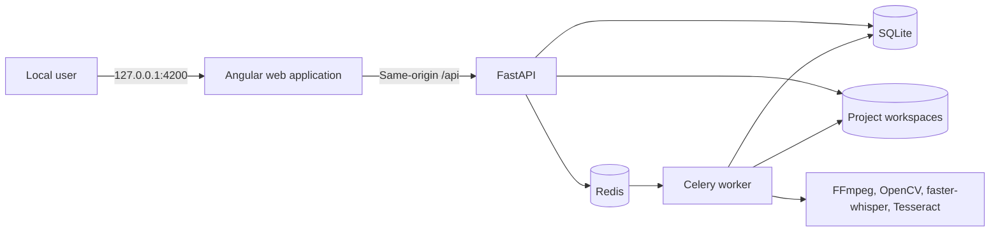
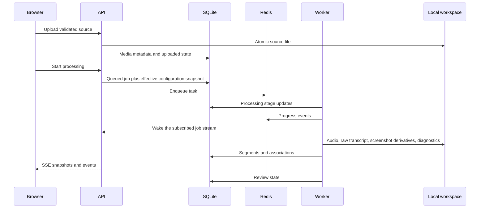
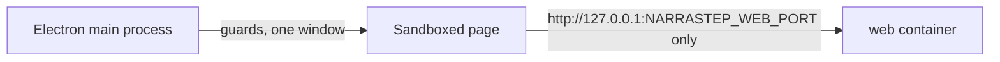
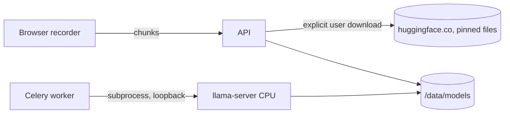

# Architecture

## System context

Narrastep is a single-user application that turns a locally uploaded screen recording into reviewable evidence and a portable documentation package. It has no authentication or required external runtime service.

## Containers and boundaries

- `web` serves static Angular assets through Nginx and proxies `/api` to FastAPI. It contains presentation and client orchestration only. Shared pixel primitives live in `apps/web/src/app/shared/ui/` (styles in `apps/web/src/styles/primitives.scss`); the icon sprite and the bundled font are static files under `apps/web/public/`. The shell (`app.component.ts`: header with the product name and a health pill fed by `GET /api/v1/health`, and the vertical menu) frames every screen; state words come from `shared/status-labels.ts` and project type labels from `shared/project-types.ts`. Interface language ([ADR 0015](decisions/0015-english-and-italian-interface.md)): `apps/web/src/app/core/i18n/` holds the language choice (`language.ts`), the startup loader that applies the active catalog from `apps/web/src/locale/` before any component runs (`init.ts`, imported first by `main.ts`), the language switch with its unsaved-changes checks (`language.service.ts`), locale-aware formatting (`format.ts`) and the translation of stable API error codes (`error-text.ts`). Texts are `i18n="@@id"` template attributes and `$localize` calls with custom IDs, never module-level constants, so they follow the language loaded at startup; the API keeps English messages and codes.
- `api` validates requests and configuration, coordinates transactions, streams local assets, and exposes durable state. Route handlers delegate business behavior to services.
- `worker` performs media and export work. It is the only service that loads the transcription model and runs with concurrency one. FFmpeg is its only media decoder: Whisper receives the samples of the extracted WAV, never a media path (P08.1), and the image build fails when FFmpeg and the Whisper packages cannot transcribe generated clips (`scripts/check_transcription_stack.py`).
- `api` and `worker` share one backend image on Python 3.14 that installs only the hashed packages of `backend/requirements.lock`, direct and transitive (P08.2, [Backend package lock](DEVELOPMENT.md#backend-package-lock)), so the same sources build the same package set.
- `redis` provides Celery queues, short-lived results, and best-effort progress notifications. It is not persistent business storage and is not published to the host. Since P08.3 the server is Valkey (BSD-3-Clause, [ADR 0017](decisions/0017-valkey-broker.md)), which speaks the same protocol; the service keeps the protocol name.
- Every image the stack builds from or pulls has an exact version tag and an index digest, listed in [Licenses](LICENSES.md#container-images) (P08.3).

The API joins the local web network and the internal processing network. The worker and Redis join only the internal network, which prevents the processing runtime from reaching the Internet.

## Processing flow

Every worker update is committed to SQLite before a best-effort Redis notification is published.
The notification wakes the subscribed API stream, which reloads the authoritative snapshot from
SQLite. Bounded resynchronization means dropped notifications never lose progress.

## Persistence

SQLite stores structured metadata and relative paths. WAL mode, foreign-key enforcement, a busy timeout, short transactions, and a single worker reduce lock contention. Large media is never stored as a database blob.

Docker mounts a named volume at `/data`. Project workspaces use UUIDs and contain source, audio,
WebP review thumbnails, optional materialized PNGs, immutable transcript evidence, content-free
diagnostics, and export archives. Repository-local `data/` is a placeholder and is not the Docker
storage path.

## Recording sessions

Implemented in P05.1 ([Recording](RECORDING.md#api)). The API, not the worker, owns recording
sessions: `POST /api/v1/recordings` creates the project and the session together, and each chunk
`PUT` streams its body straight into `recording/{track}/` of that project's workspace. Chunk
uploads do not take the per-project operation lock, because the screen and microphone tracks
upload in parallel; they are serialized instead by SQLite's write lock, taken by the first
statement of the chunk transaction (an update of the session row). That transaction checks the
session is still open, the track offset, an existing row for the sequence and the session total
before the file is renamed into place. Discarding takes the project operation lock and uses the
same staged workspace removal as project deletion. Nothing reaches Redis or the worker; no job
is queued.

Completion (P05.2, `services/recording_completion.py`) also runs in the API request, under the
project operation lock, because it is a bounded media conversion like upload validation, not
processing: FFmpeg copies the video and only encodes audio. It reads the chunk list from SQLite,
lets FFmpeg read the chunks in place through the `concatf` protocol, writes the source video and
`source/microphone.webm` (and, with system audio, `source/system.webm`, P05.5) as partial files,
validates the source with the upload's FFprobe rules, and promotes them in the transaction that marks the session `completed`. That transaction's first
statement is the session-row update, the same lock chunk uploads take, so an upload that slipped
in during the conversion is detected and the save is refused instead of losing the chunk. The
chunk rows are deleted in that transaction and the files after it; the startup cleanup removes
chunk files without rows, so a crash in between leaves nothing behind.

Storage accounting and the removal of the original video (P09.2, `services/storage.py`) run in the
API request like upload and completion. Accounting walks each project workspace with `os.scandir`
(regular files only, symbolic links skipped) and reports bytes per fixed folder. Removal takes the
project operation lock, checks that the project is `completed` with its package ZIP on disk, deletes
the files in `source/` first and then sets `media_assets.source_removed_at`, so a crash between
the two leaves a project that still offers the removal. Nothing reaches Redis or the worker; the
Storage screen (`apps/web/src/app/features/storage/`) is the only client
([ADR 0018](decisions/0018-remove-original-video-after-export.md)).

The recorder screen (P05.3, `apps/web/src/app/features/recorder/`) is the only client. The
component owns the source checks, the save step and the leave guard; `media-capture.ts` wraps the
browser capture APIs and the microphone level, which is analysed in the page and never sent; and
`recording-engine.ts` runs the two `MediaRecorder` instances and the upload queue. The engine keeps
each chunk in browser memory only until the API acknowledges it, uploads one chunk per track at a
time and retries failures that may heal (no answer, 408, 429, 5xx except 507). The recorder reads
its chunk length, bitrate and frame rate from the session response (`capture`), so the server's
settings are the only source. Saving calls the completion endpoint and nothing else: no job is
queued.

## Review and lineage

`raw-transcript.json` is immutable. Reviewed segments are active views over that evidence. Split and merge archive their source rows, create derived active rows, and record `SegmentLineage` edges in one transaction. This protects original transcription evidence while allowing structural editing.

Screenshot rows represent retained frame candidates. Associations assign primary or alternative
roles to active transcript segments. A screenshot may be associated with more than one segment.
Adaptive rows can remain `thumbnail_only`; full-size access atomically reconstructs and caches the
PNG from the same project source video. Exact-frame recovery creates both derivatives immediately
and records an explicit manual primary selection.

## Screenshot strategy boundary

The original implementation remains behind the `legacy` strategy. The separate `adaptive_v1`
service owns streaming change detection, document-unit fusion, fine decoding, global clustering,
selective OCR, and coverage budgets. Processing-job configuration snapshots prevent API and worker
environment drift. Neither service adds worker concurrency; the Celery worker remains at one.

Tesseract receives local image paths through subprocess argument arrays. TSV output is parsed in
memory into normalized token sets and discarded. Only a numeric text-change score can cross into
persistence. Language packs are image-build dependencies, never runtime downloads.

## Progress and cancellation

The worker persists a monotonic progress version and publishes a wakeup to a job-specific Redis
channel. SSE subscribes to that channel, resynchronizes from SQLite after wakeups and on a bounded
fallback interval, sends an immediate snapshot, uses the version as its event ID, emits heartbeats,
and closes at a terminal state. The browser polls the job endpoint when streaming fails.

Cancellation is best-effort and cooperative. Queued tasks can be revoked immediately; running media
work checks the persisted SQLite flag and a short-lived Redis hint between bounded units. A
reconciler detects jobs left non-terminal after a worker interruption.

## Export generation

Exports are immutable snapshots generated by the Celery worker in a temporary directory. Estimate
and generation share one pure screenshot-selection and budget function. Thumbnail-only canonical
images are materialized inside the temporary export workspace, not the mutable review workspace.
The worker writes JSON, Markdown, SRT, normalized screenshots, prompt material, and optional source
video (the prompt, batch guide and batch task wording come from the project type through
`services/export_guides.py`), creates the ZIP, then atomically promotes it into the project export directory.
The ZIP has one root folder named after the archive and numbered folders in reading order
(`services/export_names.py` builds the names, which `assign_export_name` stores on the export record when it is queued, [Data model](DATA_MODEL.md#export-layout) lists
the layout); the file on disk keeps its UUID name. Historical
exports and their actual metrics do not change when review data changes.

## Diagnostics and privacy

Each completed processing or export stage emits one JSON log event containing identifiers, counts,
durations, and sizes. Terminal per-operation diagnostics are atomically stored below the project
workspace and summarized numerically in SQLite for API, SSE, and UI use. This boundary forbids
transcript text, OCR text, filenames, absolute paths, window titles, and image content.

Nothing is measured for or sent to anyone else. FastAPI's built-in OpenTelemetry instrumentation
(FastAPI 0.142 and later) is switched off in `create_app`, including its setup of exporters from
`OTEL_*` variables, and no OpenTelemetry SDK or exporter is installed
([Licenses](LICENSES.md#fastapi-and-opentelemetry)).

## Failure handling

- API validation failures use stable error codes and never expose stack traces.
- Processing and export failures are logged with project/job identifiers and persisted without transcript content.
- Partial uploads, processing directories, and export archives are removed after failure or cancellation.
- Missing filesystem assets are reported explicitly rather than replaced with fabricated data.
- Redis or worker unavailability prevents new work from being accepted but does not erase persistent project state.

## Desktop shell

`desktop/` holds the Electron shell of [ADR 0014](decisions/0014-desktop-app-shell.md) (P07.1). It
runs on the host, outside Docker, and is a client of the `web` container like a browser tab:

- **One origin.** `src/policy.cjs` derives `http://127.0.0.1:{NARRASTEP_WEB_PORT}` (4200 by
  default) and rejects any other port value. The session cancels every request outside that
  origin (inline `data:` excepted), and every frame navigation, redirect, popup and webview outside
  it is refused (`src/guards.cjs`), so the page reaches neither the Internet nor another local
  service.
- **No host bridge.** The page runs with context isolation, the renderer sandbox and no Node.js,
  without preload script or IPC. Only `fullscreen`, the microphone (audio only, P07.4a) and
  screen capture are granted, all to the app origin; the camera, notifications, devices and
  external protocol links are denied. Downloads from the app origin open the native "Save as"
  dialog and others are cancelled (P07.4b, unit-tested with stand-ins). Screen
  capture goes through the source picker (`src/source-picker.cjs`): `getDisplayMedia()` from the app origin, and only from it, opens a
  small modal window that lists the screens and windows of `desktopCapturer` and answers the
  session's `setDisplayMediaRequestHandler` with the chosen source (or denies on cancel). The
  picker page has no script, preload or IPC; its links are cancelled navigations that the main
  process reads, and the choice is an index into the list the main process holds. The window
  passes through the same contents guards as every other window.
- **Lifecycle.** `src/shell.cjs` takes Electron's single-instance lock: a second launch exits and
  brings the window to the front, reloading the app when the window shows the fallback page.
  Closing the window quits the shell; the shell never starts, stops or calls Docker, so containers
  and running jobs continue. `src/window.cjs` shows a local English or Italian page when the app
  does not answer and a native confirmation when the page's `beforeunload` asks to stay.
- **Launcher (P07.2).** `start.sh` stays the foreground Compose process and, unless `--headless`
  is given, starts a background watcher that runs `desktop/launch.cjs`. The launcher waits for
  `/api/v1/health` through the web container, installs the pinned Electron into
  `desktop/node_modules` on the first launch with isolated npm settings (the one moment the
  desktop part uses the Internet: the npm registry and GitHub releases), then runs the shell and
  exits when the window closes. A launcher problem never stops the stack, and the window never
  outlives it: when Compose exits, the watcher stops the launcher, which first closes the window;
  on Windows the watcher's `kill` ends the window itself and the launcher recognizes its exit code
  ([Development](DEVELOPMENT.md#launcher-p072)).

## Planned boundaries

These boundaries are **planned** and not implemented. They are proposed in ADRs 0010 and 0011.

- **Recording ([Recording](RECORDING.md)).** The browser records the screen with system audio and
  the microphone as two tracks and uploads chunks. The API owns recording sessions, joins the
  chunks, aligns and mixes the tracks with FFmpeg, keeps the microphone and the system audio as
  separate tracks for speaker labels and saves the project without queuing processing. No new
  container. The session API and chunk storage exist since P05.1, the completion into the source
  video since P05.2 and the recorder screen since P05.3 (see "Recording sessions" below). Since
  P05.5 the worker labels segments You / Others by comparing the two tracks' loudness
  (`services/speaker_labels.py`, run by `services/processing.py` after transcription), and the
  review API lets the user change the label.
- **Model manager ([Local generation](LOCAL_GENERATION.md)).** The API downloads model files only
  after an explicit user action, through the `local` network, which has an Internet route. It
  verifies SHA-256 hashes and writes to `/data/models`. No project data leaves the computer.
  Since P06.2a `services/model_catalog.py` pins the repository revision and the name, size and
  SHA-256 of each file, `services/model_manager.py` keeps the install state in the
  `generation_models` table and allows only the transitions of the state diagram, and the kill
  switch `NARRASTEP_LOCAL_GENERATION=disabled` refuses new downloads. Since P06.2b
  `services/model_download.py` runs the download in a background thread of the API process (the
  only service on `local`; the worker has no route and never downloads): it requests only the
  revision-pinned files of the repository, follows a redirect only to the repository's own
  storage hosts, resumes a partial `<file>.part` with an HTTP `Range` request, stores progress in
  SQLite, hashes each file, deletes one that differs and keeps `LICENSE.txt` beside the files in
  `/data/models/<model>/`. The API start-up resumes models left `downloading` or `verifying`. The
  routes are `GET /models`, `GET /models/{id}`, `POST /models/{id}/download` and
  `POST /models/{id}/cancel`. Since P06.2c `POST /models/{id}/enable`, `POST /models/{id}/disable`
  and `DELETE /models/{id}` change the state of an installed model. Since P06.2d
  `services/model_import.py` installs the pinned files from a folder when `huggingface.co` is
  blocked: `docker-compose.yml` mounts `./data/models-import` (setting `NARRASTEP_MODEL_IMPORT_DIR`)
  as `/import`, read-only and with the SELinux `z` option, on the `api` service alone; it is the
  only bind mount of the stack and both start scripts create the folder first. The import looks
  only for the pinned file names in that folder (never a path from a request, never a link),
  copies each file into `/data/models/<model>/` through the same `downloading`, `verifying` and
  `installed` states as a download, and hashes the copies; the folder is only read. The routes are
  `GET /models/{id}/import` (what the folder holds and the license text) and
  `POST /models/{id}/import`.
- **Desktop window ([ADR 0014](decisions/0014-desktop-app-shell.md)).** A host Electron shell,
  started by `start.sh` after health, loads only the loopback web app. It supplies the screen and
  window picker, Windows loopback system audio, microphone permission and native downloads. It
  has no other host bridge, and closing it never stops the containers. The shell with its
  loopback-only loading, isolation and single instance exists since P07.1 and the launcher since
  P07.2 ("Desktop shell" above); the screen and window picker since P07.3a and Windows loopback
  system audio since P07.3b (run on a real Windows system on 2026-10-31). The microphone
  permission exists since P07.4a (unit-tested; the real-Electron window test was not run here);
  native downloads are still planned.
- **Generation.** The worker starts `llama-server` as a loopback subprocess for one generation job
  and stops it afterwards. Since P06.1 the backend image holds the pinned CPU server in
  `/opt/llama.cpp`, checked at image build by `scripts/check_llama_server.py`
  ([Local generation](LOCAL_GENERATION.md#server-in-the-backend-image)). Since P06.3c
  `app/services/llama_session.py` holds the lifecycle (memory check, start on `127.0.0.1`, health
  wait, requests, stop). Since P06.3d `app/services/generation_job.py`, run by the Celery task
  `narrastep.generate_document`, plans the chronological parts, calls the session once per part
  (and for the merge), writes `projects/{id}/generations/{generationId}/document.md` and stores
  the progress and result in the `generations` table; the API queues and cancels it
  (`/projects/{id}/generations`, `/generations/{id}`). The worker keeps no Internet route, and
  generation is serialized with processing and export by the single worker (one queue, concurrency
  one); the API refuses overlapping work on the same project. The queue and the routes are verified
  with a stand-in server only; the job ran with the real server and model in an opt-in test (P06.3e).

See the decisions under [decisions](decisions/) and the [processing pipeline](PROCESSING_PIPELINE.md).
