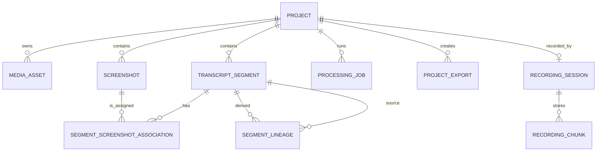

# Data Model

## Entity relationships



## Entities

### Project

Stores user metadata, project type (`output_mode`: `task_briefing`, `meeting`, `tutorial` or `general`, enforced by the `output_mode` CHECK constraint; nullable since migration `20261029_0006`: a recording has no type until processing starts, and processing refuses a project without one), requested and detected language, lifecycle status, and timestamps. The API derives the source-video and current-job references from related rows. UUIDs are never derived from project names.

Statuses are `draft`, `uploaded`, `queued`, `processing`, `review`, `exporting`, `completed`, and `failed`.

### MediaAsset

Stores a relative path, safe display metadata, MIME type, byte size, duration, dimensions, type, and creation time. Video, audio, image, and archive bytes stay on the filesystem.

### TranscriptSegment

Stores project order, timestamps, immutable row-level raw text, mutable reviewed text, optional speaker/confidence, active/archive state, and timestamps. Only active rows participate in review and export. The workspace raw transcript remains the immutable source of word-level evidence.

### Screenshot

Stores an optional full-PNG relative path, optional WebP thumbnail path, materialization state,
source timestamp, dimensions, perceptual hash, quality score, selection reason, numeric visual/text
change scores, global cluster ID, mandatory-state flag, and creation time. Existing records are
backfilled as `png_ready` with `selection_reason=legacy`; their media is not rewritten.

### SegmentScreenshotAssociation

Joins a segment and screenshot with a ranked association score, coverage score, explainable role-rank
reason, primary flag, and user-selection flag. The API presents these as `primary` or `alternative`.
A partial unique index permits at most one primary per segment. Application validation requires both
records to belong to the same project. One screenshot row can support several active segments.

### ProcessingJob

Stores Celery identity, durable status, current stage, percentage, readable message, monotonic
progress version, cancellation flag, error data, lifecycle timestamps, the immutable effective
processing configuration, versioned numeric metrics, and a safe diagnostics-relative path.

Job statuses are `queued`, `processing`, `cancelling`, `cancelled`, `completed`, and `failed`. Stages follow the documented processing pipeline.

### ProjectExport

Stores immutable export status/progress, inclusion options, relative ZIP path, byte size, error data,
timestamps, versioned actual metrics, and a safe diagnostics-relative path. Historical records are
retained after later project edits.

`sequence` is the 1-based export number within the project (unique per project; failed exports
keep theirs) and `download_name` is the ZIP name offered on download. Both are fixed when the
export is queued, so renaming the project later does not rename existing exports. Migration
`20261029_0004` numbered existing exports by creation time and left their `download_name` empty;
an empty name means a Version 0.2 export, served as `narrastep-{export UUID}.zip`.

### SegmentLineage

Records directed source-to-derived edges produced by split and merge. Source rows are archived rather than deleted, preserving structural history.

### RecordingSession

One per project made with the recorder ([Recording](RECORDING.md), P05.1, migration
`20261029_0005`); uploaded projects have none. Stores `state` (`recording` while it accepts
chunks, `completed` once the chunks became the source video in P05.2; enforced by the
`recording_state` CHECK constraint), `screen_start_offset_ms` and `microphone_start_offset_ms`
(the start of each track relative to the session's common start, as sent by the recorder; null
until a chunk of that track carries it, and never changed afterwards), `last_chunk_at`, and
timestamps. Completion (P05.2) deletes the session's chunk rows and files once the source video
is saved; the completed session row stays as the record that the project was recorded.
`project_id` is unique and cascades on project deletion. A discarded session is deleted
with its project, so there is no `discarded` state. The API reports a `recording` session as
`interrupted` when no chunk arrived for `NARRASTEP_RECORDING_INTERRUPTED_AFTER_SECONDS`; that flag
is derived on read, not stored.

### RecordingChunk

One per stored chunk: `track` (`screen` or `microphone`, `recording_track` CHECK constraint),
0-based `sequence`, `size_bytes`, the SHA-256 of the bytes and the creation time.
`(recording_id, track, sequence)` is unique (`uq_recording_chunk_sequence`), which makes a repeated
upload comparable instead of stored twice. The bytes are in the workspace file named by the track
and sequence; the row is written in the same transaction that moves the file into place.

## Storage rules

Portable paths are always relative to the configured data root. A project workspace follows this shape:

```text
projects/{project UUID}/
  source/source.ext
  audio/normalized-audio.wav
  screenshots/frame-NNNN.png
  screenshots/thumbnails/frame-NNNN.webp
  screenshots/full/{screenshot UUID}.png
  transcript/raw-transcript.json
  diagnostics/processing-{job UUID}.json
  diagnostics/export-{export UUID}.json
  exports/narrastep-{export UUID}.zip
  source/microphone.webm                (recorder projects with a microphone, P05.2)
  recording/screen/NNNNNN.webm          (open recording sessions only, P05.1)
  recording/microphone/NNNNNN.webm
```

Recording chunk files are named only from the track and the six-digit sequence; no user text
reaches the path. A chunk is streamed to `recording/{track}/.chunk-{random}.partial`, fsynced and
renamed after its row is flushed. At API startup, partial files and chunk files without a row (a
crash between the rename and the commit) are removed; the recorder still holds those chunks and
sends them again.

A saved recording's source is `source/source.webm` (`source.mkv` for video the WebM container
cannot hold) and its aligned microphone `source/microphone.webm`, on the same timeline. The media
asset's `metadata_json.recording` holds `screenChunks`, `microphoneChunks`, `microphoneShiftMs`
(null without microphone), `systemAudio` and `microphoneTrack`. Completion writes its temporary
files as `source/.upload-{token}.partial*`, which startup removes like interrupted uploads.

Temporary upload, processing, and export paths use a suffix or task-specific directory and are promoted atomically after validation.

Reviewed text is mutable structured state in SQLite. `reviewed-transcript.md` is generated inside each immutable export rather than maintained as a second mutable workspace authority.

SQLite is the only mutable project-state authority in Version 0.2. A separate mutable `project.json` snapshot is intentionally not generated because there is no import or recovery consumer that could keep it safely synchronized.

## Planned changes

**Planned**, not in the schema yet:

| Change | Package |
| --- | --- |
| `TranscriptSegment.speaker` (already present) holds `you`, `others` or null; a new `speakerSource` records `automatic` or `user` | P05.5 |
| `ModelInstall` (model key, state, downloaded bytes, verified hashes, error) with files under `models/` | P06 |
| `Generation` (project, model key, prompt version, status, progress, relative document path) | P06 |

### Export layout

Implemented in P03.2 from [ADR 0013](decisions/0013-descriptive-export-names.md), for
`2026-10-28_meeting_sprint-planning_export-02.zip`. The ZIP holds one root folder with the same
name; the folder numbers give the reading order:

```text
2026-10-28_meeting_sprint-planning_export-02/
  README.md                         what each folder contains and where to start
  01-ai-input/                      llm-input.md and the type-specific generation-prompt.md
  02-screenshots/step-003_00m42s.png
  03-transcript/                    reviewed-transcript.md, subtitles.srt, raw-transcript.json
  04-chatgpt-batches/               README.md and batch-01-of-03/ (batch-input.md plus its images)
  05-generated-document/document.md (only when included; added with local generation, P06)
  metadata/                         manifest.json (schema 0.3.0), source.json
  source/original-video.mp4         (only when requested)
```

Rules:

- The screenshot file name is `step-{nnn}_{mm}m{ss}s.png`: the number of the first step that uses
  the image and the video time at which that step starts. Batch folders hold copies with the same
  names. Batch folders are `batch-{nn}-of-{total}` (three digits once there are more than 99).
- `manifest.json` schema `0.3.0` adds `archiveName` and `paths.readme` and `paths.chatgptBatches`.
  Every `paths` value is relative to the archive root folder, not to the `metadata/` folder.
- Version 0.2 archives (schema `0.2.0`, no root folder, folders `transcript/`, `screenshots/`,
  `llm/`, `chatgpt-batches/` and `metadata/`, manifest at the top level) are never rewritten and
  are still downloaded as stored. Nothing in Narrastep reads a manifest after export, so both
  versions coexist; a future reader must switch on `schemaVersion`.
- The ZIP name and export number are computed when the export is queued and stored on the export
  record (P03.3). The worker names the root folder after the stored name; a row queued before the
  columns existed gets its name when the worker picks it up. The package on disk stays
  `exports/narrastep-{export UUID}.zip`; the download uses the stored name through the
  `Content-Disposition` header.

## Migration policy

Every schema change requires an Alembic revision, upgrade test, documentation update, and OpenAPI/status review. Migrations must not silently delete local evidence. SQLite foreign keys are enabled for all application connections, and delete cascades are used only where project deletion explicitly owns the dependent record. Alembic connections (`backend/alembic/env.py`) leave foreign keys off, so batch revisions that rebuild a parent table, such as `20261029_0003` for `projects`, cannot cascade deletes; their upgrade tests run `PRAGMA foreign_key_check` and assert that child rows survive.
