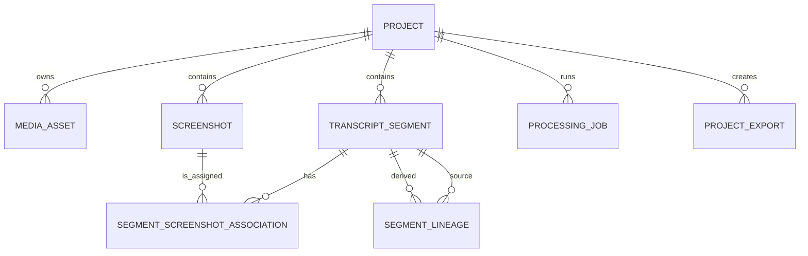

# Data Model

## Entity relationships



## Entities

### Project

Stores user metadata, project type (`output_mode`: `task_briefing`, `meeting`, `tutorial` or `general`, enforced by the `output_mode` CHECK constraint), requested and detected language, lifecycle status, and timestamps. The API derives the source-video and current-job references from related rows. UUIDs are never derived from project names.

Statuses are `draft`, `uploaded`, `queued`, `processing`, `review`, `exporting`, `completed`, and `failed`.

### MediaAsset

Stores a relative path, safe display metadata, MIME type, byte size, duration, dimensions, type, and creation time. Video, audio, image, and archive bytes stay on the filesystem.

### TranscriptSegment

Stores project order, timestamps, immutable row-level raw text, mutable reviewed text, optional speaker/confidence, active/archive state, and timestamps. Only active rows participate in review and export. The workspace raw transcript remains the immutable source of word-level evidence.

### Screenshot

Stores an optional full-PNG relative path, optional WebP thumbnail path, materialization state,
source timestamp, dimensions, perceptual hash, quality score, selection reason, numeric visual/text
change scores, global cluster ID, mandatory-state flag, and creation time. Existing records are
backfilled as `png_ready` with `selection_reason=legacy`; their media is not rewritten.

### SegmentScreenshotAssociation

Joins a segment and screenshot with a ranked association score, coverage score, explainable role-rank
reason, primary flag, and user-selection flag. The API presents these as `primary` or `alternative`.
A partial unique index permits at most one primary per segment. Application validation requires both
records to belong to the same project. One screenshot row can support several active segments.

### ProcessingJob

Stores Celery identity, durable status, current stage, percentage, readable message, monotonic
progress version, cancellation flag, error data, lifecycle timestamps, the immutable effective
processing configuration, versioned numeric metrics, and a safe diagnostics-relative path.

Job statuses are `queued`, `processing`, `cancelling`, `cancelled`, `completed`, and `failed`. Stages follow the documented processing pipeline.

### ProjectExport

Stores immutable export status/progress, inclusion options, relative ZIP path, byte size, error data,
timestamps, versioned actual metrics, and a safe diagnostics-relative path. Historical records are
retained after later project edits.

### SegmentLineage

Records directed source-to-derived edges produced by split and merge. Source rows are archived rather than deleted, preserving structural history.

## Storage rules

Portable paths are always relative to the configured data root. A project workspace follows this shape:

```text
projects/{project UUID}/
  source/source.ext
  audio/normalized-audio.wav
  screenshots/frame-NNNN.png
  screenshots/thumbnails/frame-NNNN.webp
  screenshots/full/{screenshot UUID}.png
  transcript/raw-transcript.json
  diagnostics/processing-{job UUID}.json
  diagnostics/export-{export UUID}.json
  exports/narrastep-{export UUID}.zip
```

Temporary upload, processing, and export paths use a suffix or task-specific directory and are promoted atomically after validation.

Reviewed text is mutable structured state in SQLite. `reviewed-transcript.md` is generated inside each immutable export rather than maintained as a second mutable workspace authority.

SQLite is the only mutable project-state authority in Version 0.2. A separate mutable `project.json` snapshot is intentionally not generated because there is no import or recovery consumer that could keep it safely synchronized.

## Planned changes

**Planned**, not in the schema yet:

| Change | Package |
| --- | --- |
| `Project.mode` becomes nullable; processing refuses a project without a type | P05.4 |
| `ProjectExport.sequence` and `ProjectExport.downloadName` store the number and the ZIP name that P03.2 already computes while building the archive | P03.3 |
| `RecordingSession` (state, per-track chunk count, stored bytes and start offset, timestamps) with chunks under `projects/{id}/recording/{track}/` | P05 |
| `source/microphone.webm` kept beside the mixed source video of in-app recordings | P05.2 |
| `TranscriptSegment.speaker` (already present) holds `you`, `others` or null; a new `speakerSource` records `automatic` or `user` | P05.5 |
| `ModelInstall` (model key, state, downloaded bytes, verified hashes, error) with files under `models/` | P06 |
| `Generation` (project, model key, prompt version, status, progress, relative document path) | P06 |

### Export layout

Implemented in P03.2 from [ADR 0013](decisions/0013-descriptive-export-names.md), for
`2026-10-28_meeting_sprint-planning_export-02.zip`. The ZIP holds one root folder with the same
name; the folder numbers give the reading order:

```text
2026-10-28_meeting_sprint-planning_export-02/
  README.md                         what each folder contains and where to start
  01-ai-input/                      llm-input.md and the type-specific generation-prompt.md
  02-screenshots/step-003_00m42s.png
  03-transcript/                    reviewed-transcript.md, subtitles.srt, raw-transcript.json
  04-chatgpt-batches/               README.md and batch-01-of-03/ (batch-input.md plus its images)
  05-generated-document/document.md (only when included; added with local generation, P06)
  metadata/                         manifest.json (schema 0.3.0), source.json
  source/original-video.mp4         (only when requested)
```

Rules:

- The screenshot file name is `step-{nnn}_{mm}m{ss}s.png`: the number of the first step that uses
  the image and the video time at which that step starts. Batch folders hold copies with the same
  names. Batch folders are `batch-{nn}-of-{total}` (three digits once there are more than 99).
- `manifest.json` schema `0.3.0` adds `archiveName` and `paths.readme` and `paths.chatgptBatches`.
  Every `paths` value is relative to the archive root folder, not to the `metadata/` folder.
- Version 0.2 archives (schema `0.2.0`, no root folder, folders `transcript/`, `screenshots/`,
  `llm/`, `chatgpt-batches/` and `metadata/`, manifest at the top level) are never rewritten and
  are still downloaded as stored. Nothing in Narrastep reads a manifest after export, so both
  versions coexist; a future reader must switch on `schemaVersion`.
- The archive name is computed when the worker builds the package. The export number is the
  position of the export among its project's exports by creation time; P03.3 stores it and the
  name with the export record (see "Planned changes"). The package on disk stays
  `exports/narrastep-{export UUID}.zip`.

## Migration policy

Every schema change requires an Alembic revision, upgrade test, documentation update, and OpenAPI/status review. Migrations must not silently delete local evidence. SQLite foreign keys are enabled for all application connections, and delete cascades are used only where project deletion explicitly owns the dependent record. Alembic connections (`backend/alembic/env.py`) leave foreign keys off, so batch revisions that rebuild a parent table, such as `20261029_0003` for `projects`, cannot cascade deletes; their upgrade tests run `PRAGMA foreign_key_check` and assert that child rows survive.
